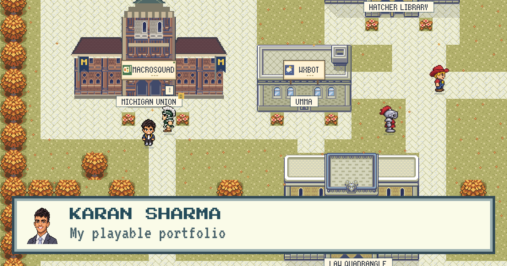

# Hi, I'm Karan

I'm a junior studying CS at Michigan. Last summer I interned at Visa. I also love building apps and have shipped two iOS apps solo and am working on a couple more. I also build fun side projects, like turning my portfolio into a game.

**[Play it at ksharm.dev](https://ksharm.dev).** It’s kind of similar to Stardew Valley and Pokémon Emerald, and you can play it on your phone too.

## Trainer card

| | |
|:--|:--|
| **Type** | Builder |
| **Second type** | Full-stack |
| **Year** | Junior, University of Michigan |
| **Expected graduation** | May 2028 |
| **Moves** | C++ · Python · TypeScript · Swift |

## Projectdex

Most of my code lives in private repos, so the portfolio is the best tour. The short version:

### Internships

- **Visa** · Software Engineering Intern, GenAI Hub · Summer 2026 
  I owned the evaluation and release system for an AI agent platform. It runs on Node.js, TypeScript, and MongoDB, with a React review interface.
- **Gallagher Kaiser** · Software Engineering Intern · Summer 2025 
  I built a monitoring service for PLC data from production lines, with a Python and FastAPI backend, a React dashboard, and Prometheus alerts.

### Projects

- **[MacroSquad](https://apps.apple.com/app/id6779122401)** · iOS app on the App Store 
  A social nutrition app with meal logs, macro goals, and a friends-only feed. I built the app, the API, and the database.
- **[Whelp](https://apps.apple.com/app/id6811374543)** · iOS app on the App Store 
  A puppy training app that turns short videos into guidance and a 14-day practice plan. I built the mobile app and the backend.
- **wxbot** · Python 
  A paper-trading engine for Kalshi and Polymarket. It runs 21 strategies on live market data, and every order goes through 11 risk checks. It never found a real edge, so it stayed in paper mode.
- **Local AI workshop** · Swift 
  I rewrote an open-source meeting assistant in native Swift. Everything runs on my Mac: Whisper on the GPU for speech, Ollama for models, and local RAG.

### Works in progress

- **Lemma** · a native iPad notes app with handwriting, typed text, and PDFs. Building Canvas integration to sync up LaTeX and other assignments.
- **Daily Planner** · my daily planner for iPhone, web, and Mac with a shared sync API.

## Say hi

[ksharm.dev](https://ksharm.dev) · [LinkedIn](https://www.linkedin.com/in/ksharma2028) · ksharm@umich.edu
